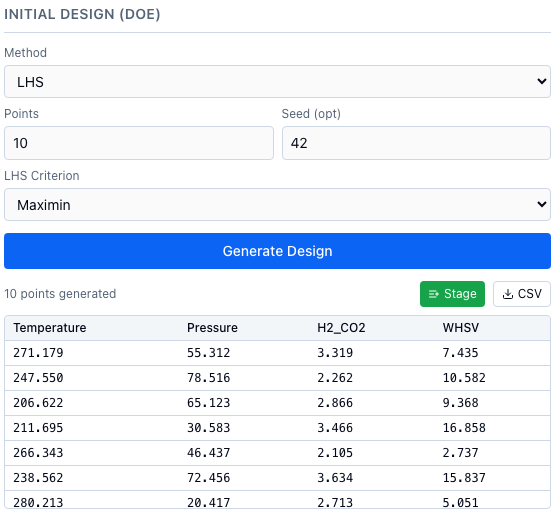
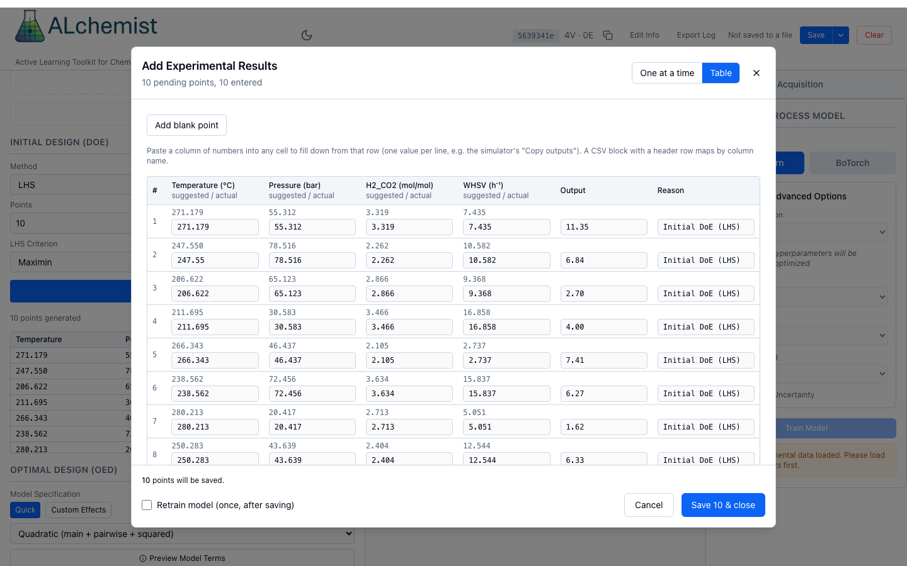
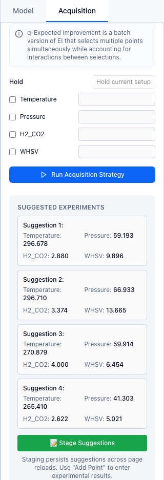

# Your first loop

This tutorial runs one optimization campaign from start to finish in the web app, about 20 minutes, with a simulated reactor standing in for the lab.

The virtual reactor below stands in for a lab: you type in the conditions ALchemist suggests, press **Run experiment**, and copy the result back. It models CO₂ hydrogenation to methanol over Cu/ZnO/Al₂O₃ (Vanden Bussche and Froment, 1996) with realistic measurement noise.

<iframe class="alc-sim" src="../tutorial/reactor/index.html" title="Virtual methanol reactor" loading="lazy"></iframe>

[Open the reactor in its own window](../tutorial/reactor/index.html){ target="_blank" }. Simulator version: commit 2ac5123.

## Before you start

Install ALchemist, start `alchemist-web` and open `http://localhost:8000`; see [Install](install.md). Put the app and the reactor (in its own window) side by side, since you will copy numbers between them.

The reactor has four settings. The goal is the methanol yield, in percent, as high as possible.

| Variable in ALchemist | Min | Max | Unit | In the simulator |
|---|---|---|---|---|
| `Temperature` | 200 | 300 | °C | Temperature |
| `Pressure` | 20 | 80 | bar (absolute) | Pressure |
| `H2_CO2` | 2 | 4 | mol/mol | H₂ : CO₂ ratio |
| `WHSV` | 1.5 | 18 | h⁻¹ | Space velocity (WHSV) |

Type the names exactly as in the first column. When you paste rows into the simulator, it reads the columns by these names.

## 1. Start a session

1. On the welcome screen, choose **New Session**.
2. Type a name, such as "Methanol reactor", and choose **Save**.

## 2. Define the variables

1. In **Variable Management**, choose **Add Variable**.
2. Type the **Variable Name**, **Min**, **Max** and **Unit (optional)** of the first row of the table, and choose **Add Variable**.
3. Repeat for the other three. The list then reads "4 variables defined".

To skip the typing, save this as `reactor_variables.json` and open it with **Load File** instead:

```json
[
  {"name": "Temperature", "type": "real", "min": 200, "max": 300, "unit": "°C"},
  {"name": "Pressure", "type": "real", "min": 20, "max": 80, "unit": "bar"},
  {"name": "H2_CO2", "type": "real", "min": 2, "max": 4, "unit": "mol/mol"},
  {"name": "WHSV", "type": "real", "min": 1.5, "max": 18, "unit": "h⁻¹"}
]
```

More on variable types and files: [Define variables](../guide/variables.md).

## 3. Generate the initial design

The model needs a first set of results that covers the whole range.

1. In **Initial Design (DoE)**, keep **Method** on **LHS** and **Points** at 10.
2. Type 42 in **Seed (opt)**. With this seed you get the same ten points as the screenshots on this site.
3. Choose **Generate Design**, then **Stage**. **Add Point...** now reads "Add Point... (10)".



*The ten design points. Copy the table, header included, to run them in the simulator.*

More: [Initial design](../guide/initial-design.md).

## 4. Run the design in the simulator

1. Select the design table from its header row to the last row (it scrolls), and copy it. Or choose **CSV** and copy the contents of the saved file.
2. Click the simulator page and paste. The setpoints turn into a queue of ten rows.
3. Choose **Run queue**. The ten runs take about ten seconds, and a table of results replaces the queue.
4. Choose **Copy outputs**. It copies the ten methanol yields, one per line, in the order of the design.

## 5. Record the results

1. In **Experiment Data**, choose **Add Point...**. The **Add Experimental Results** dialog opens.
2. Choose **Table**, click the first cell of the **Output** column, and paste. The ten yields fill the column.
3. Untick **Retrain model (once, after saving)**. There is no model yet; you train the first one yourself in the next step.
4. Choose **Save N & close**, which reads "Save 10 & close".



*The ten simulated yields, pasted in one go.*

More: [Run and record](../guide/run-and-record.md).

## 6. Train and check the model

1. In the right-hand panel, open the **Model** tab and choose **BoTorch**. Keep the settings it shows.
2. Choose **Train Model**. **Trained Model Info** shows the cross-validation RMSE, MAE and R².
3. Choose **Show Visualizations**. The centre column opens on the parity plot: each result's prediction, made by a model that did not see it, against the measured yield.

With ten points the error bars are wide, and the R² of the screenshots' run is 0.78. Your numbers differ a little, because each browser gets its own measurement noise. More: [Train a model](../guide/train.md) and [Check the model](../guide/check-model.md).

## 7. Suggest a batch of four

1. Open the **Acquisition** tab and choose **Batch**.
2. Keep **q-Expected Improvement** and **Maximize**, which are selected to start, and set **Batch Size (q)** to 4.
3. Choose **Run Acquisition Strategy**. **Suggested Experiments** lists four points.
4. Choose **Stage Suggestions**, once. **Add Point...** now reads "Add Point... (4)".



*A batch of four, staged.*

Run the four in the simulator. Choose **Back to setpoints**, type the first suggestion's four values into the setpoint fields, and choose **Run experiment**. Repeat for the others, noting each methanol yield. Then choose **Add Point...**; in the **One at a time** view, type each yield into **Output** and press Enter, or choose **Next →**, to move to the next point. Leave **Retrain model (once, after saving)** ticked, and choose **Save N & close**. The model retrains with the BoTorch settings you chose. More: [Suggest next](../guide/suggest.md).

## 8. Repeat, one point at a time

1. In the **Acquisition** tab, choose **Regular** and **Log Expected Improvement**, then **Run Acquisition Strategy** and **Stage Suggestions**.
2. Type the point's four values into the simulator's setpoint fields and choose **Run experiment**.
3. Record its yield with **Add Point...**, the retrain box ticked.

Do this two or three times. In the screenshots' run, the best yield was 11.4 % after the design and 13.8 % after the batch; the next two points went to the most hydrogen and the slowest flow at high pressure, and gave 20.9 % and 21.5 %.

## 9. Find the optimum

1. In **Model Visualizations**, choose **Plot Contour**. Put Temperature and Pressure on the axes, and move the H2_CO2 slider to its maximum and the WHSV slider to its minimum. **Show Experimental Points** and **Show Next Point** add the runs and the next suggestion.
2. In the **Acquisition** tab, under **Model Prediction Optimum**, keep **Maximize** and choose **Find Model Optimum**. It reports the point with the best predicted yield and its uncertainty.


*Predicted yield at H₂ : CO₂ = 4 and WHSV = 1.5 h⁻¹ after 16 runs.*

The simulator's true optimum, without noise, is a yield of 24.6 % at about 259 °C, 80 bar, H₂ : CO₂ = 4 and WHSV = 1.5 h⁻¹. Three settings sit at a bound, and only the temperature is inside its range, so a good campaign finds the corner quickly and spends its later runs on temperature. Between about 254 and 265 °C the yield stays within one noise standard deviation of the peak, so more runs there stop paying off: that is a reasonable place to stop.

## 10. Save the session

Choose **Save** in the header. Chrome and Edge ask where to put the file; other browsers download it. **Load Session** on the welcome screen opens it again. More: [Sessions and audit log](../guide/more/sessions.md).

!!! info "Why it works"
    Each round, the model predicts the yield everywhere with an uncertainty, and the acquisition function picks the points where a high yield is most likely, trading what the model knows against what it has not yet seen. [Bayesian optimization](../concepts/bayesian-optimization.md) explains the loop, and [Acquisition functions](../concepts/acquisition.md) the trade.

## Next

- Run the same loop from a script: [Python quickstart](../python/quickstart.md).
- Let a program run the reactor and record results without you: [The autonomous loop](../automation/loop.md).
- If something did not behave as described: [Troubleshooting](troubleshooting.md).
