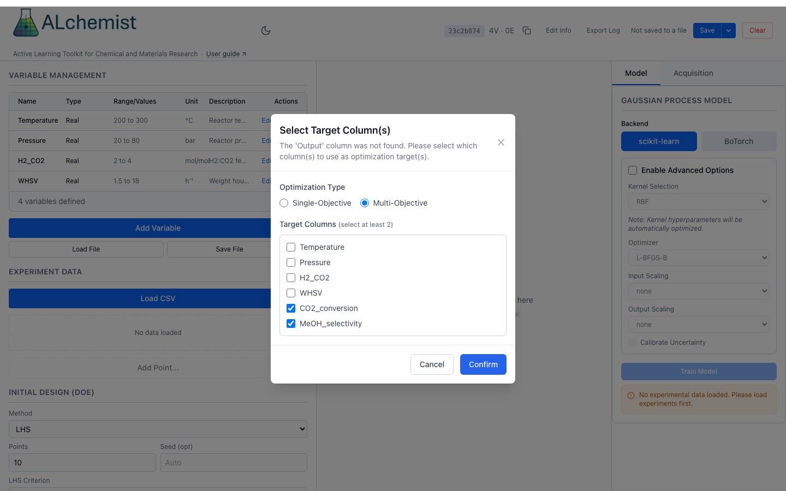
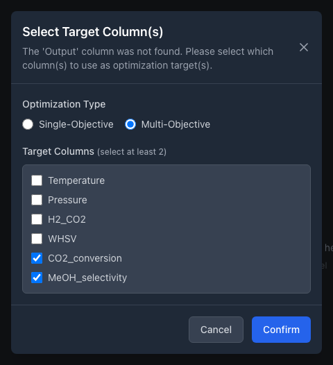

# Multi-objective

This page loads results that have two or more objectives, trains a model for each, and asks for the next experiments that push the Pareto front outward. The web app loads and trains; the multi-objective suggestion and the Pareto front are in Python for now.

{ .only-light }
{ .only-dark }

*Loading a file with two objective columns. The file has no Output column, so ALchemist asks which columns are the targets.*

## What works where

| Step | Web app | Python | REST |
|---|---|---|---|
| Load several target columns | **Load CSV**, then **Select Target Column(s)** | `load_data(path, target_columns=[...])` | `experiments/upload?target_columns=a,b` |
| Train | **BoTorch** only; no metrics shown | `train_model(backend="botorch")` | `model/train` with `"backend": "botorch"` |
| Suggest with `qEHVI` or `qNEHVI` | not offered | `suggest_next` with a `goal` per objective and a `ref_point` | `acquisition/suggest`; one goal for every objective, no `ref_point` |
| See the Pareto front | no Pareto view | `find_optimum`, `plot_pareto_frontier` | none |

Theory, including the reference point, is in [Acquisition functions](../../concepts/acquisition.md#multi-objective-ehvi).

## 1. Load data with several targets

The file holds one column for each variable and one for each objective. ALchemist reads a column named `Output` as the single objective and asks nothing, so name the objective columns something else.

1. Define the variables ([Define variables](../variables.md)).
2. In the **Experiment Data** panel, choose **Load CSV** and pick the file.
3. In **Select Target Column(s)**, choose **Multi-Objective** instead of **Single-Objective**. A list of every column in the file appears under Target Columns.
4. Tick the columns that hold objectives, at least two. Do not tick the variable columns, which the list also offers. **Confirm** stays disabled until two are ticked.

In the web app and over REST a single goal, maximize or minimize, applies to every objective. Python takes one direction per objective.

=== "Python"

    ```python
    import numpy as np
    import pandas as pd
    from alchemist_core import OptimizationSession

    rng = np.random.default_rng(11)
    session = OptimizationSession()
    session.add_variable("temperature", "real", bounds=(200.0, 300.0), unit="°C")
    session.add_variable("pressure", "real", bounds=(20.0, 80.0), unit="bar")
    session.add_variable("whsv", "real", bounds=(1.5, 18.0))

    rows = []
    for p in session.generate_initial_design("lhs", n_points=12, random_seed=11):
        t = (p["temperature"] - 200) / 100
        q = (p["pressure"] - 20) / 60
        w = (p["whsv"] - 1.5) / 16.5
        rows.append({
            **p,
            "conversion": 100 * (0.2 + 0.7 * t * (1 - 0.4 * w) + 0.1 * q) + rng.normal(0, 1),
            "selectivity": 100 * (0.9 - 0.5 * t**2 + 0.1 * q - 0.1 * w) + rng.normal(0, 1),
        })
    pd.DataFrame(rows).to_csv("two_objectives.csv", index=False)

    session.load_data("two_objectives.csv", target_columns=["conversion", "selectivity"])
    print(session.is_multi_objective, session.objective_names)
    ```

=== "REST"

    Send the file as multipart form data in a `file` field. The names are comma-separated.

    ```http
    POST /api/v1/sessions/{session_id}/experiments/upload?target_columns=conversion,selectivity
    ```

    `POST /api/v1/sessions/{session_id}/experiments/preview` takes the same file and lists its columns, which is how the app builds the dialog.

!!! note "Adding single rows"
    **Add Point...** records one output per row, so on a multi-objective session it is refused rather than leaving the other objectives empty. From Python, `add_experiment` takes a dict with every objective, `session.add_experiment({"x": 0.3}, {"conversion": 42.0, "selectivity": 88.0})`, or a list in target order; a bare float is refused with the missing objectives named. Or bring new results in as a CSV that has every objective.

## 2. Train a model for each objective

1. In the **Model** tab, choose **BoTorch**. The scikit-learn backend supports one objective and refuses the data with an error.
2. Choose **Train Model**. A message reports "Model trained successfully (2 objectives)", and **Trained Model Info** reads "Trained 2 objectives. Cross-validation metrics aren't computed for multi-objective models yet."

ALchemist fits one Gaussian process per objective. The hyperparameters in **View Hyperparameters** list them by objective name.

!!! warning "Known issue"
    A20 (the backend half of W25): a multi-objective model has no cross-validation summary over REST or in the web app. The training response's `metrics` is empty, and the parity, Q-Q and calibration plots return "Model does not have cached cross-validation results". In Python the per-objective results exist: `session.plot_parity(target_columns="conversion")` draws one objective, and `"all"` draws every one.

=== "Python"

    ```python
    results = session.train_model(backend="botorch")
    print(results["metrics"], results["n_objectives"])
    ```

=== "REST"

    ```http
    POST /api/v1/sessions/{session_id}/model/train
    Content-Type: application/json

    {"backend": "botorch"}
    ```

## 3. Suggest the next experiments

The only strategies for several objectives are `qEHVI` and `qNEHVI`, which score a candidate by the hypervolume it is expected to add above a reference point. `qNEHVI` also allows for noise in the observed values. Any other strategy is refused with "multi-objective optimization requires 'qEHVI' or 'qNEHVI'".

The web app's **Acquisition** tab lists neither strategy, so **Run Acquisition Strategy** cannot suggest for a multi-objective session there, and **Find Model Optimum** returns an error. Use Python, or REST for a suggestion.

!!! warning "Known issue"
    A19: **Find Model Optimum** and `POST /api/v1/sessions/{session_id}/acquisition/find-optimum` fail with a server error (500) on a multi-objective session. Use `find_optimum` in Python, below.

| Argument | Meaning |
|---|---|
| `strategy` | `"qEHVI"` or `"qNEHVI"`. |
| `goal` | `"maximize"` or `"minimize"` for every objective, or a list with one direction per objective. |
| `ref_point` | One number per objective, in the objectives' own units, worse than any result you would accept. Left out, ALchemist uses a point just beyond the worst observed value of each objective, recomputed on every call. |
| `n_suggestions` | The batch size. |

=== "Python"

    ```python
    suggestions = session.suggest_next(
        strategy="qNEHVI",
        goal=["maximize", "maximize"],
        n_suggestions=2,
        ref_point=[0.0, 0.0],
    )
    print(suggestions)
    ```

    Run the suggested points, add the results to the CSV and load it again. To see where the experiments stand, `find_optimum` returns the Pareto-optimal recorded experiments, and `plot_pareto_frontier` draws them for two objectives:

    ```python
    best = session.find_optimum(goal=["maximize", "maximize"])
    print(best["n_pareto"], best["objective_names"])
    print(best["pareto_frontier"][["conversion", "selectivity"]].round(1))

    fig = session.plot_pareto_frontier(directions=["maximize", "maximize"], ref_point=[0.0, 0.0])
    fig.savefig("pareto.png")
    ```

=== "REST"

    ```http
    POST /api/v1/sessions/{session_id}/acquisition/suggest
    Content-Type: application/json

    {"strategy": "qNEHVI", "goal": "maximize", "n_suggestions": 2}
    ```

    The route takes one `goal` for all objectives and has no `ref_point`, so it always uses the default.

!!! info "How ALchemist does it"
    `suggest_next` in `alchemist_core/session.py` turns every objective into a maximization, passes the reference point to BoTorch's expected-hypervolume-improvement acquisition, and checks that `goal` and `ref_point` have one entry per objective. The Pareto frontier comes from non-dominated sorting of the recorded results, so it contains experiments you have run, not model predictions; `predicted_values` in the result holds the model's prediction at each. `plot_pareto_frontier` handles exactly two objectives. How the hypervolume and the default reference point are defined is in [Acquisition functions](../../concepts/acquisition.md#multi-objective-ehvi).
