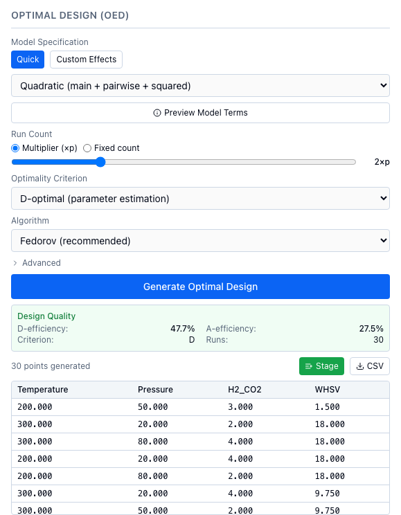

# Optimal design and AI effect suggestion

This page generates a design that is optimal for a model you name, and shows how to ask an AI model which effects that model should contain.



*A 30-run optimal design for a quadratic model on four simulated reactor variables. It was not seeded, so a new click gives different efficiencies.*

## When to use it

An optimal design assumes a model, such as temperature, pressure, their interaction and temperature squared, and picks the runs that estimate those terms best. Use it when experiments are expensive, when you can name the terms you expect to matter, or when constraints rule out the corners of a classical design. Otherwise start with a space-filling [initial design](../initial-design.md). The criteria and algorithms are in [Design of experiments](../../concepts/design-of-experiments.md#optimal-designs).

## 1. Generate an optimal design

The **Optimal Design (OED)** panel is in the left column, below **Initial Design (DoE)**.

1. Under **Model Specification**, choose **Quick** or **Custom Effects**.
2. In **Quick**, pick a model from the menu below. In **Custom Effects**, tick the terms you want (Main Effects, Interactions, Quadratic), or type more in "Additional effects (comma-separated)", such as `Temperature*Pressure` or `Temperature**2`.
3. Choose **Preview Model Terms** for the number of model columns p, the minimum runs (p), the recommended runs (2p) and the terms. It also sets the **Fixed count** to the recommended number.
4. Under **Run Count**, use **Multiplier (×p)** (a slider from 1 to 5) or **Fixed count**.
5. Pick the **Optimality Criterion** and the **Algorithm**. Under **Advanced** are the grid levels, the maximum iterations and the random seed.
6. Choose **Generate Optimal Design**. The **Design Quality** box shows the efficiencies, the criterion and the number of runs, and the points appear in a table.
7. Choose **Stage** to queue the points for **Add Point...**, or **CSV** to save `optimal_design_<criterion>_<N>pts.csv` (see the [initial design](../initial-design.md#1-generate-a-design)).

Nothing is added to the session's data until you record results; generating a design does add an audit log entry.

| **Quick** menu | Terms in the model |
|---|---|
| **Linear (main effects only)** | Intercept and one term per variable. |
| **Interaction (main + pairwise)** | Linear, plus every pair of variables. |
| **Quadratic (main + pairwise + squared)** | Interaction, plus a squared term for each real and integer variable. This is the default. |

A categorical variable adds one column per category after the first, so p counts columns, not variables.

| **Optimality Criterion** | `criterion` |
|---|---|
| **D-optimal (parameter estimation)** | `D`, the default |
| **A-optimal (min avg variance)** | `A` |
| **I-optimal (min prediction variance)** | `I` |

| **Algorithm** | `algorithm` |
|---|---|
| **Fedorov (recommended)** | `fedorov`, the default |
| **Modified Fedorov** | `modified_fedorov` |
| **DetMax (best quality)** | `detmax` |
| **Simple Exchange** | `simple_exchange` |
| **Sequential (fastest)** | `sequential` |

!!! warning "Known issue"
    T10: **DetMax (best quality)** and **Modified Fedorov** run the same exchange as **Fedorov (recommended)**, so "best quality" is not a better design. Details: [Optimal designs](../../concepts/design-of-experiments.md#optimal-designs).

=== "Python"

    ```python
    from alchemist_core import OptimizationSession

    session = OptimizationSession()
    session.add_variable("temperature", "real", bounds=(200.0, 300.0), unit="°C")
    session.add_variable("pressure", "real", bounds=(20.0, 80.0), unit="bar")
    session.add_variable("h2_co2", "real", bounds=(2.0, 4.0))

    info = session.get_optimal_design_info(model_type="quadratic")
    print(info["p_columns"], info["n_points_minimum"], info["n_points_recommended"])

    points, design = session.generate_optimal_design(
        model_type="quadratic", p_multiplier=2.0, criterion="D", algorithm="fedorov", random_seed=7
    )
    print(len(points), round(design["D_eff"], 1), round(design["A_eff"], 1))
    print(points[0])
    ```

    To name the effects yourself, pass `effects` instead of `model_type`, and `n_points` instead of `p_multiplier`:

    ```python
    points, design = session.generate_optimal_design(
        effects=["temperature", "pressure", "h2_co2", "temperature*pressure", "temperature**2"],
        n_points=12,
        criterion="I",
        algorithm="sequential",
        random_seed=7,
    )
    print(design["model_terms"])
    ```

    Run each point, then record the result with `session.add_experiment(point, output=...)`.

=== "REST"

    ```http
    POST /api/v1/sessions/{session_id}/optimal-design/info
    Content-Type: application/json

    {"model_type": "quadratic"}
    ```

    The response holds `model_terms`, `p_columns`, `n_points_minimum` and `n_points_recommended`.

    ```http
    POST /api/v1/sessions/{session_id}/optimal-design
    Content-Type: application/json

    {"model_type": "quadratic", "p_multiplier": 2.0, "criterion": "D", "algorithm": "fedorov", "random_seed": 7}
    ```

    The response holds `points`, `n_points`, `design_info` and `feasibility`, which is `null` unless the session has input constraints. To queue the points as **Stage** does, see the [initial design](../initial-design.md#from-python-or-rest) page.

## Defaults and limits

Python and REST have no default model or run count: send `model_type` or `effects`, and `n_points` or `p_multiplier` (1.0 to 10.0; the slider stops at 5). The other settings match the web app: criterion `D`, algorithm `fedorov`, `n_levels=5` (2 to 20), `max_iter=200` (10 to 10,000), and `random_seed=None`, which gives a new design on every call.

| Situation | What happens |
|---|---|
| Fewer runs than model columns | The call fails: "n_points=5 is fewer than the number of model columns p=10". Use at least p runs. |
| More runs than candidate points | The call fails. Raise the grid levels. |
| A variable appears in no effect | Its values are spread evenly over its range, in shuffled order: it varies but is not optimized. |
| A categorical variable | Allowed, but marked experimental in the code. For screening, **Full Factorial** or **GSD** are better established. |
| A squared term on a two-value discrete variable | Refused: the square equals the intercept. |
| Input constraints | Candidates are cut to the feasible region; see [Constraints](../constraints.md). |

!!! info "How ALchemist does it"
    `run_optimal_design` in `alchemist_core/utils/optimal_design.py` picks runs from a candidate grid of `n_levels` points per continuous variable, swapping points while the criterion improves, up to `max_iter` passes. Both efficiencies are reported whichever criterion you chose.

## 2. Ask an AI model which effects to include

In **Custom Effects** mode the panel has a collapsed section, **Suggest effects with AI**, marked Beta. It sends your variable names and types, the effects it may choose from, and a description you write to a language model, which picks effects and says why. No experimental results are sent. Treat the answer as a starting point.

Install the extra first; it adds `openai`, `httpx` and `edison-client`.

```bash
pip install "alchemist-nrel[llm]"
```

1. Choose **Custom Effects**, then open **Suggest effects with AI**.
2. Pick a **Provider**: **OpenAI** or **Ollama (local)**.
3. For **OpenAI**, set the **Model** (it starts at `gpt-4o`) and type an **API Key**, or leave it blank to use a saved key or the server's `OPENAI_API_KEY`. For **Ollama (local)**, check the **Base URL** (it starts at `http://localhost:11434/v1`), choose **Refresh**, and pick a **Model**.
4. Optionally tick **Edison Scientific**, a literature search that grounds the suggestion in cited papers. It takes about 10 to 20 minutes and by default gives up after 20, and the suggestion then continues without literature. Give an **Edison API Key** (or set `EDISON_API_KEY` on the server) and a **Search mode**: **Literature (standard)**, **Literature (high accuracy)** or **Precedent**.
5. Describe the system in **Experiment description**, for example "Methanol synthesis over a Cu/ZnO catalyst; maximize yield at 200 to 300 °C".
6. Choose **Suggest effects**. Cancel stops the wait.
7. The suggested effects appear as chips; one marked with a warning sign is not in your variable set. Choose Apply to checkboxes to replace the ticked terms with the suggestion. Reasoning, Literature context (Edison) and Sources open below.

Without Edison, any sources come from the model's memory, and the panel marks them as not retrieved from a literature database: check them before citing. The server keeps an Edison result in memory, so asking again with the same description is instant; "Re-run Edison" asks for a fresh search.

**Save provider settings** writes the Ollama URL and any key you typed to `~/.alchemist/config.json` on the server's machine, readable by its owner only.

!!! warning "Known issue"
    A17: **Save provider settings** writes only what is in the panel, so a key saved earlier is deleted unless you type it again first.

!!! warning "Known issue"
    A15: the provider gets your variable names and types but not their ranges or category names. Put them in **Experiment description**.

=== "Python"

    There is no `OptimizationSession` method for this step. Call the streaming REST route on a running ALchemist server, then pass the effects to `generate_optimal_design`. The block calls a provider, so the docs tests do not run it.

    ```{ .python .no-run }
    import json
    import httpx

    body = {
        "structuring_provider": {"provider": "openai", "model": "gpt-4o"},
        "system_context": "Methanol synthesis over a Cu/ZnO catalyst; maximize yield.",
    }
    url = f"http://localhost:8000/api/v1/llm/suggest-effects/{session_id}"
    with httpx.stream("POST", url, json=body, timeout=None) as response:
        for line in response.iter_lines():
            if line.startswith("data: "):
                event = json.loads(line[len("data: "):])
                if event["status"] == "complete":
                    effects = event["result"]["effects"]
    points, design = session.generate_optimal_design(effects=effects, p_multiplier=2.0)
    ```

=== "REST"

    ```http
    POST /api/v1/llm/suggest-effects/{session_id}
    Content-Type: application/json

    {
      "structuring_provider": {"provider": "openai", "model": "gpt-4o"},
      "system_context": "Methanol synthesis over a Cu/ZnO catalyst; maximize yield.",
      "edison_config": {"job_type": "literature"}
    }
    ```

    Leave out `edison_config` to skip the literature search; it also takes `api_key`, `timeout_secs` (60 to 3600, default 1200) and `force_refresh`. A provider's `api_key` is optional when a key is saved; `base_url` applies to `ollama`. The answer is a stream of server-sent events, each `data: ` followed by JSON with a `status` (progress statuses while it works); the last is `complete`, with a `result` holding `effects`, `reasoning`, `confidence`, `sources` and `disclaimer`, or `error`, with a `message`.

    `GET /api/v1/llm/config` returns the saved settings with keys masked.

!!! info "How ALchemist does it"
    `api/services/llm_service.py` tells the model to choose only from the listed effects, pick the smallest set it can justify, and cite only what the literature context contains. Effects outside your variable set are dropped when you apply the suggestion.
