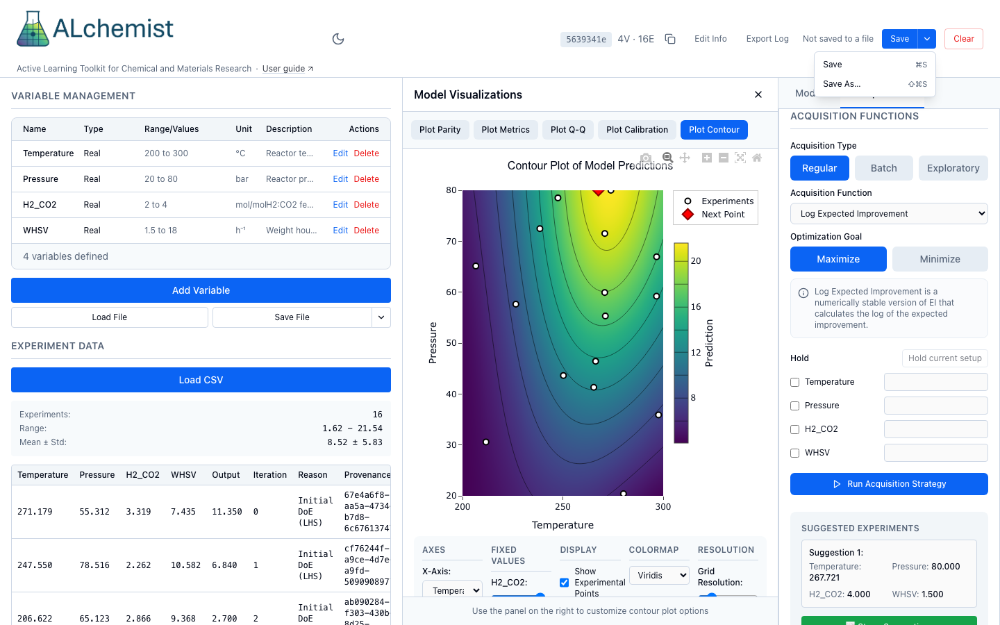

# Sessions and audit log

A session holds your variables, results, model settings and audit trail. This page saves it to a file, opens it again, and exports the audit log that records how the campaign got where it is.



*The header on a simulated session. Save and Save As… sit in one split button; before the first save it reads "Not saved to a file".*

## Where a session lives

The ALchemist server holds the session while it runs, under an ID. A saved file is the copy you keep, share or open on another server, and joining is how a second browser reaches the live session.

## 1. Start, open or join a session

| On the welcome screen | What it does |
|---|---|
| **New Session** | Creates an empty session and opens a form for its name, description, tags and author. **Edit Info** in the header reopens the form. |
| **Load Session** | Opens a saved session file as a new session, with a new ID. In Chrome or Edge on https or localhost it opens the file through the file picker and links it, so the next **Save** overwrites that file without asking. Use **Save As…** to keep the original. |
| **Join** | Opens a session that is already on the server. Type its ID into **Paste session ID...** first, then choose **Join** or press Enter. |

The header shows the first eight characters of the ID and a count such as "4V · 16E" (variables and experiments). The copy button beside it copies the full ID, and a link of the form `?session=<ID>` opens that session directly. **Clear** closes the session in this browser and forgets its linked files. It does not delete it from the server, so the same ID joins it again.

!!! warning "Known issue"
    W30: reloading the page shows the welcome screen even though the session is still on the server. Join it with its ID, or open the page with `?session=<ID>`.

!!! warning "Known issue"
    W31: after **Join** or **Load Session** the **Model** tab shows the scikit-learn defaults, not the settings the session was saved with, so choosing **Train Model** switches the model without warning. Set the backend and kernel again before you train.

## 2. Save

Choose **Save**, or press ⌘S (Ctrl+S on Windows and Linux). The arrow beside it opens a menu with **Save** and **Save As…** (⇧⌘S, or Ctrl+Shift+S). The shortcuts work whenever a session is open, and the browser's own save is turned off for them.

| Browser | **Save** | The header |
|---|---|---|
| Chrome or Edge, on https or localhost | A new session's first save asks where to put the file; a loaded session is already linked to the file it came from. After that, saves write that file in place. **Save As…** always asks and links the new file. | Shows the file's name. An amber dot before it means changes since the last save; hovering gives the time of the last save. Before the first save it reads "Not saved to a file". |
| Safari, Firefox, or any http address other than localhost, such as `http://labserver:8000` | Downloads the file each time. There is no menu, and hovering over **Save** says why. | Shows no file name and no dot. |

The link between a session and its file belongs to this browser, not to the server. After a reload Chrome asks again for permission to write the file. If the write fails, for example because the file was moved, a message says so and offers **Save As…**.

The file is named after the session title: `<title>.json`. Characters that file names forbid become `_`, a title over 120 characters is cut, and a session with no title, or the default "Untitled Session", uses `alchemist_session_` and the first eight characters of its ID. [Define variables](../variables.md#2-save-and-load-variables) describes the same behaviour for the variables file.

The dot appears after any change to what the file holds, such as variables, results, training or staged points, and not after previewing a design, plotting or predicting. Closing or reloading the page with unsaved changes asks you to confirm. As a safety net the app also copies a session that has data to the server's recovery folder every 30 seconds, and a page opened without `?session=` offers to restore the copy. A successful save clears it.

## 3. Export the audit log

Choose **Export Log**. Chrome and Edge on https or localhost show a save dialog; other browsers download. The suggested name is `<title>_audit_log.md`, built from the title in the same way. Nothing is linked, so each export asks again.

The audit log only ever has entries added. The exported Markdown has four parts.

| Part | Content |
|---|---|
| Session Metadata | Name, creation and last-modified times, description and tags. |
| Search Space Definition | Each variable with its type and range or categories. |
| Experimental Data | The results table with iteration and reason. |
| Optimization Iterations | For each iteration, the model (backend, kernel, scaling, cross-validation metrics), the acquisition (strategy, parameters, suggested points) and any initial design. |

Entries are added when you generate or stage a design, ask for a suggestion, and record results with **Retrain model (once, after saving)** ticked. The session file also keeps entries that the Markdown leaves out: configuration changes, each completed experiment with the suggested and the actual point, and pause requests.

!!! warning "Known issue"
    W34: **Stage Suggestions** writes a second acquisition entry for the same batch, with different parameters. The log then shows two entries for one round.

## 4. What the file contains

The session file is JSON: metadata, search space, data, work queue, audit log, and the model's settings and training arguments, but not the fitted model. Python's `load_session` retrains the model from those settings, so you get back the model they give on that data. The file does not record random seeds you did not set. For a methods section, export the audit log and keep the session file beside it. The keys are listed in [File formats](../../reference/file-formats.md).

=== "Python"

    ```python
    from alchemist_core import OptimizationSession

    session = OptimizationSession()
    session.update_metadata(name="Pd screening", description="Synthetic example", tags=["demo"])
    session.add_variable("temperature", "real", bounds=(200.0, 300.0), unit="°C")
    session.add_variable("pressure", "real", bounds=(20.0, 80.0), unit="bar")
    for p in session.generate_initial_design("lhs", n_points=8, random_seed=1):
        y = -((p["temperature"] - 250) / 50) ** 2 - ((p["pressure"] - 50) / 30) ** 2
        session.add_experiment(p, output=y, reason="Initial Design")
    session.train_model(backend="botorch")

    session.save_session("pd_screening.json")
    restored = OptimizationSession.load_session("pd_screening.json")
    print(restored.metadata.name, len(restored.experiment_manager.get_data()), restored.model is not None)
    ```

    `load_session` retrains the model when the file has one. To skip that, load into an existing session with `session.load_session(path, retrain_on_load=False)`. That form drops the provenance (A31; see the [Recipes](../../python/recipes.md#save-and-load-a-session) page for the workaround).

    !!! warning "Known issue"
        A16: `retrain_on_load=False` is ignored by `OptimizationSession.load_session(path, ...)`, so only the instance form, `session.load_session(path, ...)` on an existing session, skips the retrain. REST import (`POST /api/v1/sessions/import`) always retrains.

    Decisions reach the audit log in Python only when you lock them. Generating a design writes an entry by itself; a suggestion does not.

    ```python
    suggestion = session.suggest_next(strategy="EI", goal="maximize")
    session.lock_acquisition(
        strategy="EI",
        parameters={"goal": "maximize"},
        suggestions=suggestion.to_dict("records"),
        notes="Round 1",
    )
    print([entry.entry_type for entry in session.audit_log.get_entries()])

    with open("pd_screening_audit_log.md", "w") as handle:
        handle.write(session.export_audit_markdown())
    ```

    `session.export_session_json()` returns the file's content as a string, and `session.lock_data` and `session.lock_model` write the other two kinds of entry.

=== "REST"

    ```http
    POST /api/v1/sessions
    ```

    returns a `session_id`. The session's name and notes are set with:

    ```http
    PATCH /api/v1/sessions/{session_id}/metadata
    Content-Type: application/json

    {"name": "Pd screening", "description": "Synthetic example", "tags": ["demo"]}
    ```

    `GET /api/v1/sessions/{session_id}/export` returns the session file, named `session_<ID>.json`; `GET /api/v1/sessions/{session_id}/download` names it after the session title. `POST /api/v1/sessions/import` takes a file as multipart form data in a `file` field and creates a new session, so it returns a new ID. `GET /api/v1/sessions/{session_id}/audit/export` returns the audit log as Markdown, and `GET /api/v1/sessions/{session_id}/audit` returns the entries as JSON.

!!! info "How ALchemist does it"
    `OptimizationSession.save_session` in `alchemist_core/session.py` writes the file and `load_session` reads it, and the REST routes and the web app go through the same two functions. `AuditLog` in `alchemist_core/audit_log.py` only appends entries.
