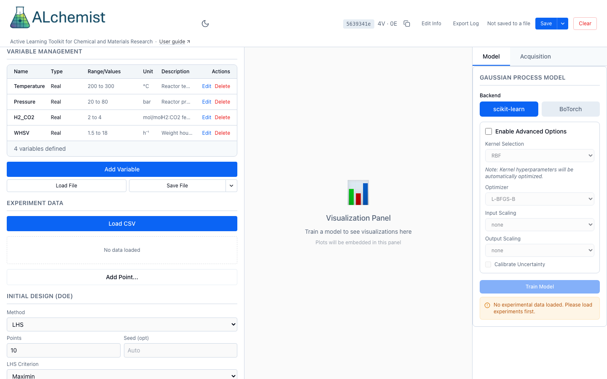
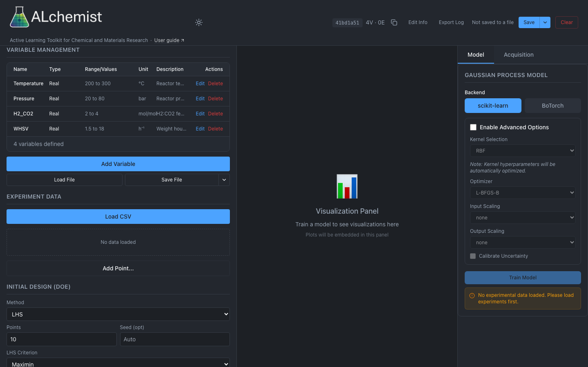

# 1. Define variables

A variable is a setting you choose for each experiment, such as a temperature or a catalyst. This page defines the variables of a session, saves them to a file and loads them back.

{ .only-light }
{ .only-dark }

*The Variable Management panel on four simulated reactor variables. Each row has Edit and Delete; the buttons below add a variable, load a file or save one. The arrow beside Save File opens the Save and Save As menu.*

## Variable types

Pick the type that matches how the setting can change.

| **Type** menu | `type` in Python and REST | You give | The variable takes |
|---|---|---|---|
| **Real (Continuous)** | `real` | **Min** and **Max** | Any number between the bounds. |
| **Integer (Range)** | `integer` | **Min** and **Max**, whole numbers | Whole numbers from Min to Max. |
| **Discrete (Specific Values)** | `discrete` | **Allowed Values**, at least two numbers, no duplicates | Only the numbers you list, such as 80, 280 and 450. |
| **Categorical** | `categorical` | **Categories**, at least one | One of the names you list. The names have no order. |

A discrete variable is a number to the model, but designs and suggestions use only the values you listed. **Unit (optional)** and **Description (optional)** are labels. They appear in the list and in saved files, and the model does not use them.

**Role** and **Changes** say whether you set a variable or only measure it, and how hard it is to change between runs. Leave them on **Controllable** and **Easy** unless you need an **Observed (measured)** variable or a split-plot design; see [Split-plot designs](more/split-plot.md).

## 1. Add a variable

1. In the **Variable Management** panel, choose **Add Variable**.
2. Type a **Variable Name**. Names are unique within a session.
3. Pick the **Type**. The fields below it change with the type: **Min** and **Max**, **Categories**, or **Allowed Values** (comma-separated).
4. For a categorical variable, type each name in **Categories** and choose **Add** (or press Enter).
5. Optionally fill **Unit (optional)** and **Description (optional)**.
6. Choose **Add Variable**. The form closes, and the list shows the variable and a count such as "4 variables defined".

The form refuses a **Min** that is not below **Max**, a categorical variable with no categories, and a discrete variable with fewer than two values or any duplicate. To change a variable later, choose **Edit** on its row and then **Update Variable**. **Delete** removes it after you confirm.

## 2. Save and load variables

**Save File** writes the session's variables to a JSON file, and **Load File** reads one. What they do depends on the browser.

| Browser | **Load File** | **Save File** |
|---|---|---|
| Chrome or Edge, on https or localhost | Opens a file picker and links the file you chose. The panel shows "Saves to" and the file name. | Writes the linked file in place. With no linked file it asks where to save, then links that file. |
| Safari, Firefox, or any http address other than localhost | Opens the browser's file chooser. Nothing is linked. | Downloads the file each time. There is no menu, and hovering over the button says why. |

In Chrome and Edge the arrow beside **Save File** opens a menu with **Save** and **Save As…**. **Save As…** always asks for a new file and links it. The link belongs to this session in this browser, and after you reload the page Chrome asks again for permission to write the file. If a save fails, for example because the file was moved or deleted, the message offers **Save As…**.

The suggested file name is `<title>_variables.json`, where the title is the session title with characters that file names forbid replaced by `_`. A session with no title, or the default "Untitled Session", uses `alchemist_session_` and the first eight characters of its ID.

A saved file is a JSON list with one object per variable. When the session has input constraints, **Save File** writes an object with `variables` and `constraints` instead, so a file opened with **Load File** keeps its constraints when you save it again. Categories are stored as `values`, and `role` and `changes` appear only when they are not the defaults. This example is a session without constraints, so it is the bare list.

```json
[
  {"name": "temperature", "type": "real", "min": 300.0, "max": 500.0, "unit": "°C"},
  {"name": "catalyst", "type": "categorical", "values": ["A", "B", "C"]},
  {"name": "SAR", "type": "discrete", "allowed_values": [80.0, 280.0, 450.0]},
  {"name": "ambient", "type": "real", "min": 15.0, "max": 30.0, "role": "observed"}
]
```

!!! warning "Known issue"
    W36: loading a plain list adds its variables to the ones already defined, one at a time. A name that already exists stops the load with an error, and the variables listed before it stay added. Load into an empty session, or use an object with a `variables` key, such as a file saved from Python or from **Save File** on a session with constraints. That form replaces the whole search space, constraints included, and a file with any error is refused whole; it is described under [Constraints](constraints.md#save-and-load-constraints).

## From Python or REST

=== "Python"

    ```python
    from alchemist_core import OptimizationSession

    session = OptimizationSession()
    session.add_variable(
        "temperature", "real", bounds=(300.0, 500.0), unit="°C", description="Reactor temperature"
    )
    session.add_variable("batches", "integer", bounds=(1, 10))
    session.add_variable("catalyst", "categorical", categories=["A", "B", "C"])
    session.add_variable("SAR", "discrete", allowed_values=[80, 280, 450])
    session.add_variable("ambient", "real", bounds=(15.0, 30.0), role="observed")
    print(session.get_search_space_summary()["n_variables"])
    ```

    Save the variables and load them into another session:

    ```python
    session.search_space.save_to_json("variables.json")

    other = OptimizationSession()
    other.load_search_space("variables.json")
    print([v["name"] for v in other.search_space.variables])
    ```

=== "REST"

    Each type has its own body. The request takes `min` and `max` for `real` and `integer`, `allowed_values` for `discrete`, and `categories` for `categorical`.

    ```http
    POST /api/v1/sessions/{session_id}/variables
    Content-Type: application/json
    ```

    ```json
    {"name": "temperature", "type": "real", "min": 300.0, "max": 500.0, "unit": "°C"}
    ```

    ```json
    {"name": "catalyst", "type": "categorical", "categories": ["A", "B", "C"]}
    ```

    `GET /api/v1/sessions/{session_id}/variables/export` returns the list above, and `POST /api/v1/sessions/{session_id}/variables/load` takes the file as multipart form data. Add `?include_constraints=true` to the export to get the object form with constraints.

!!! info "How ALchemist does it"
    The search space is a list of variables, each stored with its type and bounds; see the [SearchSpace reference](../reference/python/search-space.md). A name cannot be `WholePlot`, `Subplot` or `RunOrder`, which split-plot designs use as column names. Over REST a name cannot be empty, contain `/`, or be `.` or `..`, because the name is the address used to delete the variable.
